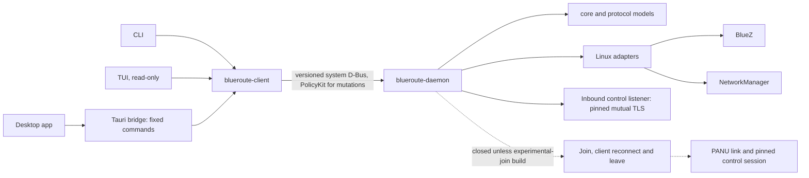

# BlueRoute Specification

**Project:** BlueRoute  
**Repository:** `ekkus93/blueroute`  
**Document status:** Initial architecture specification  
**Product target:** Linux computers with supported Bluetooth hardware and Bluetooth PAN support  
**Initial development environment:** Debian 13 with BlueZ, NetworkManager, and systemd  
**Initial physical test hardware:** Dell Chromebook 3100 units are one convenient validation platform, not a product requirement  

## 1. Purpose

BlueRoute is a friendly Linux application for creating ordinary TCP/IP networks over Bluetooth without requiring Wi-Fi infrastructure. It is intended to make Bluetooth PAN networking practical for non-expert users while retaining strong command-line, diagnostic, and automation interfaces for administrators and developers.

BlueRoute is a **general Linux networking product**, not a Dell Chromebook application. Any Linux computer should be a potential BlueRoute node when its operating system, Bluetooth adapter/driver, BlueZ stack, and Bluetooth PAN/BNEP support satisfy the documented runtime requirements. Hardware-specific behavior is discovered, measured, and represented as capability data rather than encoded as model-specific assumptions.

Dell Chromebook 3100 systems running Debian are useful early development machines because they are available for hands-on testing. They are test fixtures, not the definition of supported hardware.

BlueRoute uses standard Linux Bluetooth PAN facilities rather than Bluetooth Mesh as the IP transport. Bluetooth links use BNEP with PAN roles such as PANU and NAP. Linux IP routing connects multiple PAN segments when a larger or multi-hop topology is needed.

The project has one shared Rust networking engine and multiple front ends:

- a background daemon that owns network state and keeps networking alive when no UI is open;
- a command-line interface for scripting, administration, and diagnostics;
- a terminal user interface for interactive use without a graphical desktop;
- a Tauri desktop application designed for non-technical users.

A later release may optionally route client traffic to the Internet through a BlueRoute node that has another usable uplink such as Ethernet, Wi-Fi, cellular, USB networking, or another routed interface. Internet sharing is not required for the initial LAN release, but the architecture must allow it without redesigning the core routing model.

## 2. Product scope and platform policy

### 2.1 Product scope

BlueRoute targets Linux computers, including but not limited to:

- laptops;
- desktops;
- Chromebooks converted to Linux;
- single-board computers;
- mini PCs;
- embedded Linux systems capable of running the daemon and required system services.

A device is not supported merely because it has a Bluetooth logo. Support depends on the complete Linux Bluetooth/PAN path actually working: controller, firmware, kernel driver, BlueZ, PAN/BNEP capabilities, and the network configuration backend.

### 2.2 Initial software baseline

The first implementation and packaging effort targets Debian 13 because it provides a stable development baseline. The initial production backend may require:

- Linux;
- BlueZ;
- Bluetooth PAN/BNEP support;
- NetworkManager;
- systemd and system D-Bus;
- a Bluetooth adapter whose Linux stack can perform the required PAN roles.

These are **software/runtime requirements**, not hardware-model requirements.

### 2.3 Portability requirement

Core logic must not depend on:

- Dell-specific hardware IDs;
- Chromebook-specific paths or firmware names;
- one Bluetooth controller family;
- one adapter's maximum peer count;
- one fixed interface name;
- one fixed radio range, MTU, throughput, or latency;
- one computer's power/battery behavior.

Those properties belong in runtime capability discovery, configuration, policy, diagnostics, or hardware test evidence.

### 2.4 Backend portability

The first Linux network backend may use NetworkManager. The architecture must isolate NetworkManager behind a typed adapter so a future backend for systemd-networkd, direct netlink, or another Linux network manager can be added without rewriting topology, identity, routing policy, or UI code.

## 3. Product principles

1. **Normal IP networking.** Applications see ordinary IP connectivity. SSH, HTTP, rsync, NFS, TCP, UDP, and normal IP software require no BlueRoute library.
2. **Standard Bluetooth PAN.** Use Linux Bluetooth PAN/BNEP rather than inventing an IP-over-Bluetooth-Mesh transport.
3. **Linux routing for multi-hop.** Multi-segment behavior is implemented with layer-3 routing between PAN links.
4. **Hardware agnostic by design.** Hardware limits are capabilities and measurements, never assumptions tied to one model.
5. **Use system networking primitives.** Orchestrate BlueZ, NetworkManager, the kernel routing stack, and established Linux services instead of reimplementing Bluetooth or TCP/IP.
6. **One engine, many interfaces.** CLI, TUI, and Tauri front ends use the same daemon API and domain model.
7. **Network survives UI exit.** Closing a UI must not tear down an active BlueRoute network.
8. **Friendly defaults.** Ordinary users should not need to understand PANU, NAP, BNEP, route metrics, NAT, or forwarding tables.
9. **Automatic recovery.** Temporary Bluetooth loss, service restarts, peer restarts, and topology changes should normally reconcile automatically.
10. **Least privilege.** Front ends are unprivileged; privileged operations go through narrow system-service and authorization boundaries.
11. **Diagnosable.** Simple user health status and detailed administrator diagnostics are both first-class requirements.
12. **Future gateway support.** Internet sharing is separate, opt-in, and modeled independently from Bluetooth link establishment.

## 4. Functional goals

BlueRoute shall eventually support:

- discovering nearby BlueRoute-capable Linux devices;
- pairing/trusting devices through a friendly workflow;
- creating a named BlueRoute network;
- joining and leaving an existing BlueRoute network;
- forming Bluetooth PAN links using standard Linux facilities;
- assigning and managing IP addresses automatically;
- providing normal IPv4 connectivity between directly connected members;
- routing traffic across multiple PAN segments;
- automatically selecting suitable PAN roles and topology;
- adapting policy to controller and system capabilities;
- reconnecting after transient failures;
- displaying node, link, route, topology, and health state;
- stable machine-readable CLI output;
- a Ratatui TUI;
- a polished Tauri desktop application;
- system-service integration and packaging;
- diagnostics suitable for heterogeneous Linux hardware;
- optional future Internet gateway advertisement, selection, forwarding, DNS, and NAT;
- future alternative Linux network backends without changing the core domain model.

## 5. User-experience goals

A non-technical user should be able to:

1. Open BlueRoute.
2. Choose **Create a Network** or select a nearby network and choose **Join**.
3. Complete a simple trust/pairing step if required.
4. See a clear connected/healthy state.
5. Use ordinary applications over the resulting IP network.

The UI may expose advanced diagnostics, but normal workflows must not require Bluetooth PAN or Linux routing terminology.

The product should report unsupported or partially supported hardware in user-centered language, for example:

- “Bluetooth is unavailable.”
- “This Bluetooth adapter does not support the required network mode.”
- “Your Linux Bluetooth service is not running.”
- “This system can join a network but cannot currently act as a hub.”

## 6. Non-goals

The initial project does not aim to:

- implement HCI, L2CAP, BNEP, TCP, UDP, IPv4, or IPv6 stacks;
- tunnel arbitrary IP packets through the Bluetooth Mesh protocol;
- replace BlueZ;
- become a Wi-Fi mesh manager;
- promise Wi-Fi-equivalent throughput;
- claim that every Linux/Bluetooth combination works without validation;
- provide Internet sharing in the first proof-of-concept milestone;
- expose an Internet uplink without explicit user opt-in;
- make hardware-model-specific code the normal solution to controller differences;
- expose raw topology controls as the default desktop experience.

## 7. Terminology

### Node
A Linux computer running the BlueRoute daemon.

### BlueRoute network
A logical trusted group of nodes that may form one or more PAN segments and route IP traffic between members.

### PAN
Bluetooth Personal Area Networking using BNEP.

### PANU
Bluetooth PAN User role. A node attaches to a PAN provider.

### NAP
Bluetooth Network Access Point role. A node accepts PAN clients and anchors a PAN segment.

### PAN segment
One local BNEP/IP segment consisting of a NAP and one or more PANU peers.

### Routed topology
A BlueRoute network with multiple PAN segments and one or more Linux nodes forwarding IP traffic between them.

### Direct peer
A node reachable over a direct Bluetooth PAN relationship.

### Routed peer
A node reachable through one or more BlueRoute routing nodes.

### Gateway
A BlueRoute node that optionally offers a route from the private BlueRoute network to an external network or the Internet.

### Capability
A discovered, measured, configured, or negotiated property of a node or adapter, such as whether it can act as NAP, whether routing is allowed, or how many simultaneous links should be attempted.

### Control plane
BlueRoute messages used for identity, membership, capability, topology, route, and health coordination.

### Data plane
Normal user IP traffic carried across PAN links and routed by Linux.

## 8. High-level architecture

```text
                         Linux system

                 +-------------------------+
                 |   blueroute-daemon      |
                 |       Rust              |
                 |-------------------------|
                 | identity/membership     |
                 | capabilities            |
                 | topology                |
                 | addressing              |
                 | route decisions         |
                 | reconnect/recovery      |
                 | health/diagnostics      |
                 +------------+------------+
                              |
                       system D-Bus
                              |
              +---------------+----------------+
              |                                |
          +---v---+                    +-------v--------+
          | BlueZ |                    | NetworkManager |
          +---+---+                    +-------+--------+
              |                                |
        Bluetooth/BNEP                  interfaces,
                                         addresses,
                                         routes, DNS,
                                         forwarding

                              ^
                              |
                     BlueRoute local API
                              |
              +---------------+----------------+
              |               |                |
       +------v-----+   +-----v------+   +-----v---------+
       | CLI        |   | TUI        |   | Tauri desktop |
       | blueroute  |   | blueroute- |   | blueroute-    |
       |            |   | tui        |   | desktop       |
       +------------+   +------------+   +---------------+
```

The daemon is authoritative for active network state. Front ends must not independently manipulate BlueZ, the network manager, interfaces, or routes.

### Current implementation status and boundaries

This specification describes the product target. The following status records what the current Rust workspace actually wires together; planned behavior above must not be read as evidence that the feature is already available.

#### Implemented software boundaries

Status reviewed 2026-11-13 (code-review remediation, CR-F7). "Implemented" means implemented and tested in software; physical Bluetooth acceptance is tracked separately and is still outstanding for everything joining involves.

- `blueroute-core` contains hardware-independent identifiers, configuration, membership (schema v3 with a persisted host/client role), health, capability, address allocation, NAP admission policy, topology and route-planning models.
- `blueroute-protocol` contains the versioned local D-Bus command/response/event types (API 1.7), bounded control-frame codecs, replay/session models and strict peer claims.
- `blueroute-linux` contains direct system-D-Bus adapters for BlueZ and NetworkManager, PAN lifecycle operations, address/route/forwarding ownership helpers, durable state stores, service-owner observation and the read-only system capability probe.
- `blueroute-client` provides the version-gated system-D-Bus client used by every front end. Each operation is bound to one validated daemon owner (CR-F8), an event subscription ends when that owner goes away or is replaced even without an event (CR-F2), including while an event's version is being checked, and an event is delivered only if its owner still holds the name after that check (FU-02). A subscription belongs to one continuous ownership period: once its owner gives the name up, the subscription is over even if the same connection takes the name back (A→B→A). Ownership notices are ordered against the final `GetNameOwner` reply by receive position, and a returning owner is reached only through a fresh, revalidated subscription (LC-OWNER). The one shared watcher behind the desktop and TUI reconnects with bounded backoff and rereads on every change signal.
- `blueroute-daemon`:
  - hosts networks (create, startup restore, a 15-second running check that repairs the host after BlueZ or NetworkManager restarts, and leave, including after a failed restore);
  - runs the inbound control listener, which admits only peers whose keys are pinned, over mutual TLS 1.3 with an exporter-bound Hello, up to the configured NAP policy ceiling;
  - holds the full join path (confirmed-host record, PANU, owned lease, supervised pinned control session, commit-time host authorization), restart reconciliation and link-loss reconnection for a joined client, and observation-based client leave;
  - accepts typed key enrollment on both sides (`RecordJoinHost` on the joiner, `EnrollPeerKey` on the host);
  - reports health, capabilities, diagnostics (including the host's authenticated control peers) and the client link, and announces every observable change with the `StateChanged` signal (API 1.7, §11);
  - checks hosting against the latest capability observation, so recovery needs no restart (§13);
  - removes its owned networking on package removal through a root-only maintenance mode (§31).
- `blueroute` (CLI) covers every daemon command with JSON output and typed exit codes. `blueroute-tui` is a full-screen, read-only Ratatui interface that shows the CLI command for each action. The desktop app (Tauri, React) shows status, creates and leaves networks, retries a joined client's link, renames the computer and diagnoses problems. Its only mutations are `create_network`, `leave_network`, `retry_client_reconnect` and `set_device_name`, each individually granted; the daemon still enforces PolicyKit.

#### Incomplete end-to-end behavior

- **Production join is closed.** Every packaged and CI build refuses `JoinNetwork` and every client-runtime mutation. Only a build with the default-off `experimental-join` Cargo feature, meant for two-machine test rigs, can open the gate, and only with every join dependency wired. No join has run on hardware yet, so joining, restart reconnection, link-loss recovery and client leave are unproven on a radio.
- The desktop Join workflow (P12-006) stays disabled until join passes hardware acceptance.
- **Topology distribution is designed, not built.** The control wire carries no route, topology or membership messages. Origin-signed link-state is accepted as direction (P8-005) and deferred until the first two-node join passes. Route planning, segment allocation, failover and forwarding remain software models with no live multi-segment topology to act on.
- **Diagnostics are partial.** The daemon reports local health and capabilities, owned interface addresses on a host, and the host's authenticated control peers. It does not report observed PANU links per peer, routes or a topology graph.
- **Adapter changes and suspend are not handled while running.** An adapter power cycle, re-plug or suspend/resume (P13-004/005) depends on BlueZ and controller behavior that has not been observed.
- **Packaging is Debian only.** `blueroute` ships the daemon, CLI and TUI; `blueroute-desktop` is a separate package. Clean install, upgrade and uninstall on real systems are not yet qualified (removal cleanup is tested with fakes and an isolated dpkg database only).
- Internet sharing is not implemented and remains disabled by default.



The implementation backlog and acceptance status are maintained in [TODO.md](TODO.md); physical evidence and deferred hardware requirements are tracked in [HARDWARE_ACCEPTANCE_BACKLOG.md](HARDWARE_ACCEPTANCE_BACKLOG.md).

## 9. Proposed Rust workspace

```text
blueroute/
├── Cargo.toml
├── docs/
│   ├── SPEC.md
│   └── TODO.md
├── crates/
│   ├── blueroute-core/
│   ├── blueroute-protocol/
│   ├── blueroute-linux/
│   └── blueroute-client/
├── apps/
│   ├── daemon/
│   ├── cli/
│   ├── tui/
│   └── desktop/
│       ├── src-tauri/
│       └── src/
└── tests/
```

### `blueroute-core`

Hardware-independent domain logic:

- identities;
- capability model;
- topology graph;
- link/path scoring;
- route planning;
- state machines;
- addressing policy;
- health model;
- configuration model;
- events and domain errors.

It must contain no Dell/Chromebook assumptions, shell commands, BlueZ object paths, NetworkManager object paths, or UI types.

Topology graph invariants (CR-F3): every link's endpoints are nodes, its segment exists and has the same NAP, and its PANU is a member of that segment; a segment's members are exactly its NAP, the PANUs of its links, and members added explicitly before insertion (which must be nodes, and stay until the node is removed). `add_segment` returns `true` for a new segment, whose members are rebuilt from this graph (its NAP, explicit members, and the PANUs of its links here), so a segment cloned from another graph never brings members justified only there (FU-03); reinserting an existing SegmentId with the same NAP keeps it and its members (`false`); a different NAP is refused. `add_link` returns `true` for a new link; the same LinkId with the same segment and endpoints updates only state, health and cost (`false`); any other change of an existing LinkId is refused rather than rebound. Every check runs before mutation, so a refused call leaves the whole graph unchanged, and removing one of several links to a member keeps it a member.

### `blueroute-protocol`

Shared versioned protocol types:

- local API version;
- commands and responses;
- events;
- status snapshots;
- diagnostics;
- inter-node control envelopes where appropriate;
- compatibility rules.

### `blueroute-linux`

Linux-specific adapters:

- BlueZ D-Bus client;
- Bluetooth discovery and pairing;
- PANU/NAP lifecycle;
- NetworkManager backend;
- interface inspection;
- address and route application;
- forwarding/firewall adapters;
- system capability discovery;
- Polkit integration where necessary.

The crate must expose typed interfaces to the core rather than leak D-Bus types across the architecture.

### `blueroute-client`

Reusable daemon client for CLI, TUI, and Tauri backend:

- daemon connection;
- API version negotiation;
- typed request helpers;
- event subscriptions;
- daemon-restart reconnection;
- shared presentation/view models where useful.

### Applications

- `blueroute-daemon`: long-running network service;
- `blueroute`: CLI;
- `blueroute-tui`: Ratatui UI;
- `blueroute-desktop`: Tauri desktop UI.

## 10. Daemon model

The daemon is a long-running system service on the initial Debian/systemd backend.

Responsibilities include:

- own BlueRoute configuration and runtime state;
- discover platform and Bluetooth capabilities;
- observe BlueZ and network-manager state;
- create and tear down PAN links;
- perform membership and topology logic;
- apply addresses and routes;
- maintain peer control sessions;
- reconnect/reconcile when policy allows;
- expose a stable local API;
- emit state-change events;
- persist durable settings and trust state;
- produce structured diagnostics.

The daemon must not require a graphical session. Active networking continues after all front ends exit.

## 11. Local daemon API

The initial local IPC mechanism is system D-Bus. A versioned service/interface namespace should be reserved early, for example:

```text
org.blueroute.Service1
/org/blueroute/Service1
```

Representative semantic operations:

- `GetStatus`
- `GetCapabilities`
- `ListNetworks`
- `CreateNetwork`
- `JoinNetwork`
- `LeaveNetwork`
- `ListNodes`
- `GetNode`
- `SetDeviceName` (a display label kept owner-only in the state directory; never part of identity, keys, membership or authorization)
- `StartDiscovery`
- `StopDiscovery`
- `TrustPeer`
- `ForgetPeer`
- `RecordJoinHost` / `ClearJoinHost` (joiner-side host record; not membership, see P6-004 addendum)
- `EnrollPeerKey` (API 1.5, P7-003: on a node in a network, trust a peer and pin the control key its operator read out with `peer local-key`; typed before first contact, then proven by mutual TLS on every connection. A different existing pin is refused; `ForgetPeer` removes both)
- `GetClientLink` / `RetryClientReconnect` (restart and link-loss reconnection of a joined client; see P6-009 and P6-010). Once established, the reconnector watches the supervised control session; when it ends by itself (link, TLS or idle loss) a fresh bounded reconnect starts, while a session stopped by a leave is not a loss. The reconnector makes a bounded number of attempts with capped backoff, then stops, keeps `Member`, reports `Degraded` and waits for the user. Health reports the worse of the capability observation and the reconnection state.
- Errors: standard `org.freedesktop.DBus.Error.*` names, plus `org.blueroute.Error.AddressConflict` (API 1.6) when a network's private IPv4 range overlaps one already in use. Clients classify failures by exact name only, never by message text.
- `GetDiagnostics` (API 1.4 adds `authenticated_control_peers`: the host's peers with a live authenticated control session, reported against the labelled policy ceiling; control sessions, not PANU links, and not a radio limit)
- future `SetInternetSharing`

Representative events:

- network discovered/lost;
- node discovered/changed;
- node connected/disconnected;
- capabilities changed;
- network joined/left;
- topology changed;
- route changed;
- health changed;
- Internet availability changed;
- authorization required/failed.

The typed events above are the protocol's vocabulary; the current daemon does not emit them yet.
What it does emit (API 1.7) is the payload-free `StateChanged(revision u64)` signal, after every
change a client could observe in its snapshots: a mutating request (announced whether it succeeded
or not, since a failure is recorded in diagnostics), and worker observations of health,
capabilities, system diagnostics, authenticated control peers and the joined client's link phase.
One publisher thread owns emission. It is woken by marks from the request path and the workers and
also rechecks the in-memory snapshots every 250 ms; a separate sampler thread reads the network list every second (sooner after a request, each read bounded by 10 s, a timeout counting as a failed read), so a slow membership store or BlueZ never delays an announcement (FU-01). Shutdown cancels a pending read and joins both threads, so a change
reaches connected observers within one second even from a producer that does not mark. It emits
outside every state lock; unchanged observations and failed reads emit nothing (a failed read's caller already has the error, and announcing it would make every front end repeat it); bursts coalesce into one pending
invalidation that is never dropped; a failed emission is logged without payload and retried, and
never turns a committed change into a failed request. Receivers treat a signal only as "reread":
the revision orders signals of one daemon process and is not a state version. The publisher also announces once when it starts and once when its first network sample lands, so a change made before its baselines existed is never absorbed silently (FU-05). Front ends also
reread when a new owner-bound subscription is established, so a change between their first read
and the subscription is never missed (CR-F1).

All public IPC interfaces are versioned. Clients must fail clearly on incompatible daemon versions.

## 12. Bluetooth and Linux networking integration

### 12.1 BlueZ

Production Bluetooth operations should use BlueZ D-Bus APIs rather than parsing `bluetoothctl` output. Development shell tools may be used during characterization only.

Required areas:

- adapter enumeration and state;
- device discovery;
- device properties;
- pairing and trust;
- connection state;
- PAN profile access;
- NAP registration and PANU connection through the selected production boundary;
- error mapping;
- capability and failure reporting.

### 12.2 BNEP/PAN data plane

The data plane is standard Bluetooth PAN using BNEP.

Initial proof-of-concept topology:

```text
             NAP node
          /     |     \
       PANU    PANU   PANU
```

The exact number of PANU clients is adapter/system dependent. BlueRoute must not assume a universal limit.

### 12.3 NetworkManager

The initial Debian backend should use NetworkManager D-Bus for IP/network state where practical. Production code must not depend on parsing `nmcli`.

NetworkManager-specific implementation belongs behind the Linux network-backend abstraction.

### 12.4 No Bluetooth Mesh IP tunneling

BlueRoute does not encapsulate arbitrary TCP/IP packets into Bluetooth Mesh messages. Multi-hop connectivity is provided by Linux IP routing between standard PAN links.

## 13. Capability model

Hardware and software differences are expected and must be explicit.

A node capability snapshot may include:

- Bluetooth adapter present/usable;
- controller/driver identity for diagnostics;
- PANU support;
- NAP support;
- practical simultaneous-link limit or policy ceiling;
- routing/forwarding capability;
- available network backend;
- power/battery information where available;
- observed link-quality information;
- external connectivity present;
- future willingness to share Internet.

Capabilities may be **discovered**, **measured**, **configured**, or **conservatively defaulted**. Diagnostics should distinguish these sources where useful.

Capability freshness (CR-F4): the daemon probes capabilities at startup and again every 15 seconds. Each observation is published in status and, under the same lock, handed to the operation-time hosting gate, so `CreateNetwork` and host restoration check the latest observation, never a startup copy: recovery is usable without a restart, and a lost or failed observation (a failed probe publishes unknown) closes the gate again. Readiness only describes the last observation; creation still requires authorization, no current membership, a free address range and backend success, and a prerequisite lost after the check fails the backend step with the normal rollback. Recording an observation never touches networking. Two copies are latched at startup on purpose: the control worker's and join control's `connection_policy_ceiling`, which is configured policy rather than a live measurement, and the capabilities they describe themselves with in `Hello`, which no current receiver uses for any decision.

A capability failure on one node should not unnecessarily make the entire network unsupported. For example, a node that can act only as a client may still participate as PANU.

## 14. Network topology

### 14.1 Single-star baseline

The first operational milestone is one NAP with one or more PANU clients and ordinary IP traffic between members.

### 14.2 Interconnected stars

Larger networks may use multiple PAN segments:

```text
        client A       client B
            \             /
                hub 1
                  |
                  | routed PAN relationship
                  |
                hub 2
              /       \
        client C     client D
```

Traffic from client A to client D is routed IP traffic:

```text
client A -> hub 1 -> hub 2 -> client D
```

### 14.3 Routing, not giant bridging

The preferred multi-segment architecture is layer-3 routing rather than one large bridged layer-2 domain. This reduces loop/broadcast problems and makes path ownership explicit.

### 14.4 Automatic role selection

Ordinary users do not select PANU/NAP roles. The topology engine considers:

- candidate direct neighbors;
- node/adapter capabilities;
- practical connection ceilings;
- current node degree/load;
- link stability/quality where measurable;
- path cost/hops;
- power status where relevant;
- gateway capability in later releases;
- topology stability and anti-flap policy.

A device model name is never a topology-policy input by itself.

### 14.5 Topology convergence

BlueRoute should favor a healthy existing topology over constant optimization. Hub loss or range loss should trigger bounded reformation where alternate physical links exist.

## 15. Addressing

### 15.1 IPv4 first

Initial production networking uses IPv4. Each routed PAN segment should have a distinct private subnet selected from a BlueRoute-managed pool.

BlueRoute must detect conflicts with active local networks and avoid installing overlapping routes.

### 15.2 Identity is not address

Logical node identity is independent of Bluetooth MAC address, IP address, interface name, hostname, and display name.

### 15.3 DHCP vs explicit assignment

NetworkManager shared-mode DHCP may be used for early single-star prototypes, but final multi-segment addressing must support deterministic orchestration. The addressing abstraction must prevent an early DHCP choice from becoming a protocol assumption.

### 15.4 IPv6

IPv6/ULA support is planned. Core destination and identity models must not require redesign when IPv6 is added.

## 16. Routing

The Linux kernel forwards packets. BlueRoute computes desired route state and applies it through a network backend.

The route model must support:

- BlueRoute segment/prefix destinations;
- logical-node destinations where needed;
- reachability and next hop;
- metric/path cost;
- ownership so BlueRoute removes only its own state;
- future default/Internet routes.

Route decisions should account for reachability, link state, path cost, freshness, topology stability, and optional gateway preference.

The first routed version may centrally compute routes if that simplifies correctness. Babel or another mature dynamic-routing protocol may be evaluated later after PAN behavior is characterized.

## 17. Inter-node control plane

BlueRoute needs authenticated, versioned control communication separate from user traffic.

Control information may include:

- stable node identity;
- network identity;
- software/protocol version;
- capabilities;
- neighbor/link observations;
- membership state;
- topology state;
- route information;
- health;
- future gateway advertisements.

Messages must be bounded and validated. Source IP or Bluetooth display name alone is not proof of BlueRoute identity.

**Current decision:** The selected transport is TCP over the PAN data plane with mutually authenticated TLS 1.3 and explicit per-node SPKI key pins. See [P7-001-CONTROL-TRANSPORT.md](P7-001-CONTROL-TRANSPORT.md). Key verification and live daemon transport integration remain implementation gates; this decision does not enable production joining by itself.

A proposed production-join design (operator-confirmed host identity, untrusted peer locator, pinned dial, per-network supervisor) is recorded as an unreviewed addendum in [P6-004-JOIN-ORCHESTRATION.md](P6-004-JOIN-ORCHESTRATION.md); it changes no invariant until accepted.

## 18. Identity, pairing, and trust

BlueRoute distinguishes:

1. Bluetooth device pairing/trust managed through BlueZ.
2. BlueRoute network membership managed by BlueRoute.

Bluetooth pairing does not automatically grant membership.

Each installation has a stable generated node identity and a user-editable display name. Each BlueRoute network has a stable network identity and a human-friendly name.

The initial enrollment flow may use explicit approval. Future invitation codes/QR enrollment may be added.

## 19. Security and privilege requirements

- Front ends run unprivileged.
- Privileged networking uses the narrowest practical daemon/system-service boundary.
- Prefer BlueZ/NetworkManager D-Bus APIs over privileged shell commands.
- Use D-Bus/Polkit policy where appropriate.
- Never construct shell commands from peer-controlled data.
- Validate all local IPC and peer protocol input.
- Persist secrets with restrictive permissions.
- Treat display names and Bluetooth metadata as untrusted presentation data.
- Do not automatically expose an Internet uplink.
- Internet sharing is explicit, visible, and reversible.
- Logs redact secrets and credentials.
- Forget/revoke operations require clear user intent.

A formal threat model is required before production-ready automatic multi-node trust or Internet gateway support.

## 20. Persistence

Durable state may include:

- node identity;
- display name;
- known BlueRoute networks;
- membership/trust data;
- remembered peers;
- user preferences;
- topology policy overrides;
- future gateway preferences.

Transient state such as interface names, RSSI, live routes, and temporary IP addresses is not durable identity.

Persistent schemas must be versioned and migrations tested.

## 21. Reliability and reconciliation

BlueRoute must expect:

- Bluetooth adapters disappearing/reappearing;
- adapters with different feature sets;
- peers moving out of range;
- suspend/resume;
- daemon restart;
- BlueZ restart;
- NetworkManager restart;
- stale BNEP interfaces;
- pairing failures;
- address conflicts;
- partial network partitions;
- hub loss;
- simultaneous topology events.

Recovery should reconcile desired state against observed BlueZ, network-manager, interface, address, and route state rather than assume prior commands succeeded.

Retries must be bounded with backoff and retryability classification.

## 22. Future Internet gateway extension

Internet sharing is post-core-product and disabled by default.

A node may eventually report:

- external connectivity present;
- connectivity type;
- Internet reachability verified;
- willingness to share;
- gateway preference/cost.

“Has Internet” and “willing to share Internet” are distinct.

Potential path:

```text
BlueRoute client
      |
      v
one or more routed PAN segments
      |
      v
BlueRoute gateway
      |
      v
Ethernet / Wi-Fi / cellular / other uplink
      |
      v
Internet
```

Gateway implementation must cover forwarding, NAT/masquerading where required, DNS, default-route advertisement/selection, firewall policy, cleanup, loop prevention, and optional failover.

The gateway backend may use NetworkManager shared networking or explicit nftables/forwarding, depending on proven topology needs.

## 23. CLI requirements

Representative commands:

```text
blueroute status
blueroute capability show
blueroute network list
blueroute network create <name>
blueroute network join <id-or-name>
blueroute network leave
blueroute node list
blueroute node show <id>
blueroute peer trust <id>
blueroute peer forget <id>
blueroute discover
blueroute diagnose
```

Read-only commands should support stable JSON output. Exit codes should distinguish usage/configuration, daemon unavailable, authorization failure, unsupported capability, and operational failure.

The CLI is a daemon client, not a second network implementation.

## 24. TUI requirements

The Ratatui TUI should provide:

- overall status;
- nearby/known networks;
- connected nodes;
- node details;
- capabilities;
- diagnostics;
- settings.

Keyboard interactions should be discoverable on screen and usable without a graphical session.

## 25. Tauri desktop requirements

The desktop application is the primary non-technical experience.

Prominent actions:

- Create a Network
- Join
- Leave
- Devices
- Settings
- Diagnose a Problem

Default terminology should say:

- “network” rather than “PAN segment”;
- “device/computer” rather than “PANU”;
- “connected through another device” rather than “multi-hop routed peer”;
- “Internet sharing” rather than “NAT/default-route advertisement.”

The desktop UI should adapt to capabilities. It must not offer a role/action that the local system cannot perform, and it should explain why when useful.

The Tauri Rust backend uses `blueroute-client`; browser-side code never receives unrestricted system D-Bus or shell access.

## 26. Diagnostics and observability

Diagnostics should include:

- BlueRoute and daemon/API versions;
- Linux distribution/kernel;
- BlueZ version/state;
- network-backend version/state;
- Bluetooth adapter/controller/driver identity;
- discovered capabilities and their source;
- current BlueRoute network;
- direct and routed peers;
- BNEP/PAN interfaces;
- addresses;
- BlueRoute-owned routes;
- topology graph;
- recent state transitions/errors;
- authorization failures;
- future gateway state.

The daemon logs to journald on systemd systems. Support bundles, when added, must redact secrets.

## 27. Error model

At minimum distinguish:

- unsupported platform/runtime;
- missing Bluetooth adapter;
- adapter disabled;
- required PAN capability unavailable;
- BlueZ unavailable;
- network backend unavailable;
- peer unavailable;
- pairing rejected/failed;
- authorization denied;
- PAN setup failure;
- address conflict;
- route application failure;
- topology failure;
- protocol incompatibility;
- corrupt persisted state;
- internal error.

Front ends convert these into audience-appropriate messages while preserving low-level context for advanced diagnostics.

## 28. Hardware and platform characterization

BlueRoute must characterize **capability classes**, not one computer model.

For every hardware/software combination used for acceptance, record:

- system/vendor/model for reproducibility only;
- Linux distribution and kernel;
- BlueZ and network-backend versions;
- controller/chipset and kernel driver;
- PANU/NAP behavior;
- reliable simultaneous link count;
- connection establishment/reconnection behavior;
- sustained TCP/UDP stability;
- latency/throughput;
- CPU/memory use;
- suspend/resume behavior where applicable;
- range-loss recovery;
- routed two-hop behavior where applicable.

Dell Chromebook 3100 machines may provide the first such report. At least one materially different Linux/Bluetooth hardware platform should be included before making broad v1 portability claims.

No controller limit should become a global constant. Policy uses per-node capabilities, conservative defaults, or measured/configured ceilings.

## 29. Testing strategy

### Unit tests

Deterministic core tests cover identifiers, serialization, state machines, capability handling, topology, routes, addressing, policy, health aggregation, and migrations.

### Adapter tests

Linux adapters use trait boundaries and fakes/mocks to test D-Bus translation, errors, idempotency, and reconciliation.

### Network integration tests

Linux network namespaces/virtual interfaces should test route/address logic independently of physical Bluetooth where possible.

### Hardware acceptance

Physical tests prove Bluetooth claims. CI must never be presented as proof that a Bluetooth controller behaves correctly.

The acceptance matrix should include multiple adapters/hardware classes over time, not only the initial Chromebook fixtures.

### UI tests

- CLI contract/JSON tests;
- TUI state/view tests;
- Tauri component tests;
- desktop end-to-end tests against a fake/test daemon;
- selected full-stack hardware workflows.

## 30. CI and quality gates

The repository should enforce, as introduced:

- `cargo fmt --all -- --check`;
- clippy under an agreed warning policy;
- Rust unit/integration tests;
- frontend formatting/lint/type checks;
- Tauri/frontend tests;
- documentation checks where practical;
- dependency/security checks as appropriate;
- reproducible packaging checks.

Hardware acceptance remains a separate gate.

## 31. Packaging and installation

Initial packaging target is Debian. The installed package set may include:

- `blueroute-daemon`;
- CLI;
- TUI;
- desktop application;
- systemd unit;
- D-Bus service/policy files;
- Polkit files if required;
- desktop metadata/icons;
- configuration directories;
- man pages/documentation.

Uninstall must not leave active BlueRoute routes, forwarding, NAT/firewall rules, or unintended network profiles.

How (CR-F5, [CR-F5-REMOVAL-CLEANUP.md](CR-F5-REMOVAL-CLEANUP.md)): on `remove`/`deconfigure`, `prerm` stops the service and runs `blueroute-daemon --remove-owned-networking`, a root-only maintenance mode that holds the daemon's instance lock, leaves a marker that keeps any daemon from starting, removes the NetworkManager state owned by the networks this installation knows, and succeeds only when a reobservation finds none left. For a joined-client network it first disconnects the PANU link it can prove is ours and observes it gone; if Bluetooth is unreachable, the host device is unknown, or BlueZ has no object for it, that network's state is kept as proof and cleanup fails (FU-04). A network whose role cleanup cannot establish (an active membership with no stored role, or a client record without a membership) is left untouched and fails cleanup too, even with nothing left to remove; only a completed leave (`not-member`) or a known role is cleaned (LC-CLEANUP). Resources owned by networks this installation does not know are preserved and reported. A cleanup failure fails `prerm`, so dpkg aborts the removal and `postinst abort-remove` restarts the service. Upgrades tear nothing down. Durable state is kept on remove and deleted on purge, which always follows a successful cleanup. The daemon never enables forwarding and creates no routes, NAT or firewall rules, so there are none to remove.

Future distribution packaging may be added without changing the daemon/core architecture.

## 32. Support matrix

Every release should publish a support/test matrix using software and capability criteria rather than a single device model.

It should list:

- tested distributions;
- minimum/tested kernel versions;
- BlueZ versions;
- network backend and versions;
- tested Bluetooth controllers/hardware examples;
- observed role/connection limitations;
- known driver/firmware issues;
- packaging status by distribution.

A listed computer model is evidence of testing, not an architectural requirement.

## 33. Performance and resource expectations

Bluetooth performance varies substantially by controller, radio environment, BlueZ/kernel behavior, topology, and hop count. BlueRoute must not publish a universal throughput or peer-count promise without evidence.

BlueRoute is intended for workloads such as management, SSH, local services, application control, and file transfer where Bluetooth performance is acceptable.

The daemon should be lightweight on modest Linux hardware. Idle CPU should be near-zero apart from necessary timers/events, and discovery scanning should not run continuously without policy justification.

## 34. Initial release layering

### Layer A — PAN proof of concept

- two compatible Linux nodes;
- one NAP and one PANU;
- IPv4 connectivity;
- TCP and UDP traffic;
- exact capabilities/versions recorded.

### Layer B — Managed single-star network

- daemon;
- persistent identities;
- multiple clients where capabilities permit;
- automatic addressing;
- create/join/leave;
- CLI diagnostics;
- reconnection.

### Layer C — Routed interconnected stars

- multiple PAN segments;
- forwarding;
- topology graph;
- automatically applied routes;
- multi-hop TCP/IP;
- failure recovery.

### Layer D — Friendly applications

- TUI;
- Tauri desktop workflow;
- packaging and installation.

### Layer E — Internet gateway

- explicit opt-in;
- forwarding/NAT/DNS;
- gateway advertisements;
- default-route selection;
- optional failover.

## 35. Core-product acceptance

BlueRoute reaches its initial local-network objective when, on the documented supported Linux baseline:

1. A non-technical user can create a network from the desktop app.
2. Another compatible Linux device can discover and join it from the desktop app.
3. IP networking works without manual `ip`, `nmcli`, or `bluetoothctl` commands.
4. Ordinary TCP/UDP applications work.
5. Closing the UI does not stop networking.
6. Temporary connectivity loss results in understandable state and automatic recovery when possible.
7. CLI, TUI, and desktop show the same daemon state.
8. Diagnostics explain platform capabilities, interfaces, addresses, peers, topology, and routes.
9. Multi-segment routing is physically proven before the product claims routed-topology support.
10. Behavior is not dependent on Dell Chromebook-specific code or assumptions.
11. Internet sharing remains absent/off until its separate acceptance criteria are complete.

## 36. Open engineering questions

These should be answered with prototypes/ADRs rather than assumptions:

- Which BlueZ/NetworkManager API boundary is most reliable for PANU/NAP lifecycle?
- How consistently do common Linux Bluetooth controllers expose PAN roles?
- What capability probes can reliably distinguish supported/unsupported role combinations?
- How should BlueRoute choose a conservative connection ceiling before hardware-specific measurements exist?
- What pre-PAN mechanism best identifies a device as BlueRoute-capable?
- What enrollment method best balances friendliness and trust security?
- What IPv4 pool minimizes collisions?
- What inter-node control transport/authentication best fits PAN links?
- Should routed topology be centrally coordinated, distributed, or hybrid?
- Is Babel or another routing protocol advantageous after PAN constraints are understood?
- Which D-Bus/Polkit permissions are required on the initial Debian backend?
- How should suspend/resume affect hub responsibility?
- Which link-quality metrics are portable enough for topology policy?
- When should a node decline a hub role because of controller limits or power state?
- What gateway/NAT approach best fits routed multi-segment networks?
- What abstraction is needed to add a non-NetworkManager Linux backend later?

## 37. Architectural invariants

Unless deliberately revised:

1. BlueRoute targets compatible Linux computers, not a specific computer model.
2. Hardware-dependent behavior is modeled as capability/policy data.
3. BlueRoute carries normal IP over standard Bluetooth PAN/BNEP links.
4. Bluetooth Mesh is not the IP transport.
5. Multi-hop connectivity is solved at the IP routing/topology layer.
6. The daemon is authoritative for network state.
7. CLI, TUI, and desktop share the daemon API.
8. Front ends do not require root privileges.
9. The core is separated from Linux/BlueZ/network-backend adapters.
10. NetworkManager is an initial backend, not a core-domain dependency.
11. Internet sharing is a distinct, opt-in gateway feature.
12. The default UI hides low-level networking concepts.
13. Hardware connection limits are measured/discovered/configured rather than globally assumed.

## 38. Documentation requirements

As implementation progresses, maintain:

- architecture decision records;
- developer setup instructions;
- protocol/API documentation;
- daemon D-Bus documentation;
- platform support matrix;
- hardware capability/test reports;
- troubleshooting guide;
- packaging/install guides;
- user guides for desktop/TUI/CLI;
- security/threat-model documentation.

This document defines the intended architecture and product direction. `docs/TODO.md` decomposes it into implementation tasks and acceptance gates.
